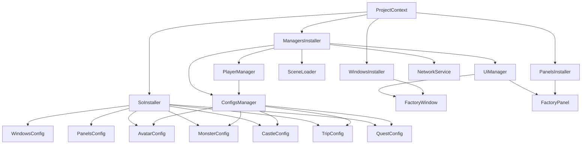

# Zenject / Extenject — архитектура зависимостей EnchantedLand

> Документ основан на текущем коде репозитория. В нём описана подтверждённая конфигурация ProjectContext, а непроверенные SceneContext bindings обозначены как требующие проверки в Unity.

## 1. Для чего используется DI

Zenject (форк Extenject) отвечает за создание объектов и передачу им зависимостей. Вместо того чтобы каждый класс самостоятельно искал другие объекты через `FindObjectOfType`, `Singleton` или глобальные вызовы, зависимости объявляются в конструкторе или через `[Inject]`.

В проекте DI используется для:
- общих менеджеров: `UiManager`, `SceneLoader`, `ConfigsManager`, `PlayerManager`, `NetworkService`;
- ScriptableObject-конфигураций;
- фабрик окон и панелей;
- инъекции в компоненты сцен и UI.

## 2. Подтверждённая конфигурация ProjectContext

Файл `Assets/Resources/ProjectContext.prefab` содержит Zenject `ProjectContext`. В нём сериализованы:
- `SoInstaller` как ScriptableObject installer;
- несколько MonoInstaller, среди которых `ManagersInstaller`, `PanelsInstaller` и `WindowsInstaller`.

`ProjectContext` предназначен для bindings, которые должны быть доступны между сценами и жить в течение приложения. Это соответствует текущей регистрации общих менеджеров.

### ManagersInstaller

Файл: `Assets/Common/Scripts/Installers/ManagersInstaller.cs`

В `InstallBindings()` регистрируются:

```csharp
Container.BindInterfacesAndSelfTo<UiManager>().AsSingle().NonLazy();
Container.BindInterfacesAndSelfTo<SceneLoader>().AsSingle().NonLazy();
Container.BindInterfacesAndSelfTo<ConfigsManager>().AsSingle().NonLazy();
Container.BindInterfacesAndSelfTo<PlayerManager>().AsSingle().NonLazy();
Container.BindInterfacesAndSelfTo<NetworkService>().AsSingle();
```

Значение регистраций:
- `AsSingle()` — один экземпляр на соответствующий контейнер.
- `BindInterfacesAndSelfTo<T>()` — объект можно разрешать как сам класс и как реализуемые интерфейсы.
- `NonLazy()` — объект создаётся во время установки контейнера, даже если его никто ещё не запросил. Сейчас этот флаг явно указан для первых четырёх менеджеров, но не для `NetworkService`.

Поскольку `NetworkService` зарегистрирован как `BindInterfacesAndSelfTo<NetworkService>()`, он может разрешаться и как `NetworkService), и как `INetworkService`. Важно не создавать параллельные экземпляры через отдельные bindings.

## 3. ScriptableObject Installer

Файл: `Assets/Common/SO/SoInstaller.cs`

Installer регистрирует экземпляры:
- `WindowsConfig`;
- `PanelsConfig`;
- `AvatarConfig`;
- `MonsterConfig`;
- `СastleConfig`;
- `TripConfig`;
- `QuestConfig`.

Для каждой конфигурации вызывается `Container.BindInstance(...).IfNotBound()`. Это позволяет инжектировать назначенный в asset экземпляр конфигурации в другие классы.

Проверьте в Inspector, что все обязательные поля `SoInstaller.asset` назначены. Регистрация null-ссылки не создаст корректную игровую конфигурацию.

## 4. Граф зависимостей



Схема отражает bindings, подтверждённые кодом. Фабрики создаются в соответствующих installers, а сами UI prefab должны быть назначены в конфигурациях.

## 5. ConfigsManager и PlayerManager

### ConfigsManager

Получает пять игровых конфигураций через constructor injection. Затем предоставляет их через read-only свойства. Это упрощает доступ к данным, но сам менеджер не должен становиться местом хранения изменяемого состояния игровой сессии.

### PlayerManager

Получает `ConfigsManager` через конструктор и загружает локальные данные игрока. Поскольку он зарегистрирован в ProjectContext как singleton, один экземпляр живёт между сценами в рамках текущего приложения.

Не путайте этот локальный менеджер с серверным авторитетным состоянием игрока. Его `PlayerData` и файл JSON не реплицируются автоматически по сети.

## 6. Фабрики окон и панелей

### WindowsInstaller

`WindowsInstaller` получает `WindowsConfig` через `[Inject]` и объявляет фабрику:

```csharp
Container.BindFactory<WindowType, BaseView, FactoryWindow>()
    .FromMethod(InitWindow);
```

Фабрика находит prefab по `WindowType` через `WindowsConfig.GetWindow(window)`, а затем создаёт компонент `BaseView` вызовом `Container.InstantiatePrefabForComponent<BaseView>(go)`. Такой путь создания позволяет Zenject выполнить инъекцию в создаваемом prefab.

### PanelsInstaller

Работает аналогично: получает `PanelsConfig`, находит prefab по `PanelType` и создаёт `BasePanelView` через `InstantiatePrefabForComponent`.

Если фабрика возвращает null, проверьте, что тип зарегистрирован в enum и соответствующий prefab назначен в ScriptableObject-конфигурации.

## 7. Как внедряются зависимости

### Constructor injection — предпочтительно для обычных C# классов

```csharp
public class ExampleService
{
    private readonly PlayerManager _playerManager;

    public ExampleService(PlayerManager playerManager)
    {
        _playerManager = playerManager;
    }
}
```

Преимущества: обязательные зависимости видны в конструкторе, поля можно сделать readonly, объект легче тестировать.

### Field/property injection — для Unity-компонентов

```csharp
public class ExampleView : MonoBehaviour
{
    [Inject] private UiManager _uiManager;
}
```

Unity создаёт `MonoBehaviour` самостоятельно, поэтому обычный constructor injection для такого компонента не подходит. Создавайте prefab через Zenject factory либо явно инжектируйте уже созданный объект.

### Method injection

В проекте `NetGameScenesManager` использует:

```csharp
[Inject]
public void Construct(
    DiContainer container,
    NetworkService networkService,
    PlayerManager playerManager,
    UiManager uiManager)
{
    _container = container;
    _networkService = networkService;
    _playerManager = playerManager;
    _uiManager = uiManager;
}
```

Этот способ группирует обязательные зависимости и удобен для Unity-компонентов, если контейнер действительно участвует в создании/инъекции объекта.

## 8. Важный случай: сетевой prefab NGO

Сетевые объекты часто создаются через `NetworkManager` и NGO, а не через Zenject factory. В таком случае атрибут `[Inject]` сам по себе не гарантирует заполнение поля.

В текущем `NetPlayer` есть `[Inject] public PlayerManager _playerManager`, а в `NetGameScenesManager` остался закомментированный вызов `_container.InjectGameObject(playerObject.gameObject)`. Следовательно, текущий код не доказывает, что `PlayerManager` реально инжектируется в spawned PlayerObject.

Выберите единый жизненный цикл:
1. **Рекомендуемый для простых сетевых prefab:** передавать сетевые данные через `NetworkVariable`/RPC, а локальные сервисы подключать отдельным composition component с контролируемой инъекцией.
2. **Явная инъекция:** вызвать `DiContainer.InjectGameObject` в контролируемой точке до первого использования полей с зависимостями. Убедиться, что вызов не выполняется повторно на одном объекте.
3. **Фабрика:** если архитектура допускает создание до NGO spawn, использовать фабрику Zenject для создания и подготовки объекта, затем выполнить сетевой spawn в правильном порядке.

Не полагайтесь на то, что NGO и Zenject автоматически интегрированы: стандартный NGO spawn не является вызовом Zenject factory.

## 9. ProjectContext и SceneContext

- **ProjectContext** — глобальные зависимости приложения; в текущем проекте это общие менеджеры, конфигурации и UI-фабрики.
- **SceneContext** — зависимости конкретной сцены: ссылки на локальные объекты сцены, spawn points, игровые контроллеры и scene-specific factories.

В дереве репозитория не обнаружен отдельный пользовательский installer для сетевой сцены среди основных installers. Это не доказывает отсутствие SceneContext в самих сценах; откройте `NetGame.unity` в Unity и проверьте объект `SceneContext`, список installers и их bindings. Не регистрируйте общий `NetworkService` повторно в каждом SceneContext, если нужен единый сервис между сценами.

## 10. Порядок разрешения зависимостей

Упрощённый порядок:
1. Zenject создаёт ProjectContext и выполняет его installers.
2. Создаются bindings ScriptableObject и singleton-сервисов.
3. При загрузке сцены запускается SceneContext и выполняет scene installers, если они настроены.
4. Zenject инжектирует компоненты, созданные через его контейнер/фабрики.
5. NGO может создать PlayerObject отдельным жизненным циклом; DI для него надо обеспечить отдельно.

Не обращайтесь к инжектированному полю в `Awake`/сетевых callbacks, пока не гарантирован порядок инъекции. Для сетевых объектов особенно важно, чтобы зависимости были готовы к `OnNetworkSpawn`.

## 11. Частые ошибки

### Зависимость равна null

Проверьте:
- класс зарегистрирован в том контейнере, который создаёт объект;
- тип регистрации совпадает с типом параметра;
- поле конфигурации назначено в Inspector;
- объект создан через Zenject или явно инжектирован;
- метод `Construct` завершился до использования зависимости.

### Два экземпляра одного сервиса

Проверьте, нет ли одновременной регистрации одного класса через `AsSingle` в ProjectContext и в SceneContext. Также не создавайте его вручную через `new NetworkService()`.

### Installer не видит конфигурацию

Убедитесь, что `SoInstaller` находится в `ProjectContext` или в том же контейнере/родительском контейнере, из которого разрешается installer.

### Сетевая зависимость не инжектируется

Проверьте путь создания PlayerObject. Если его создаёт NGO, используйте явно контролируемую DI-инъекцию или архитектурно отделите локальные сервисы от NetworkBehaviour.

## 12. Рекомендуемые улучшения

1. Везде, где потребителю нужен только контракт, инжектировать `INetworkService`, а не конкретный `NetworkService`.
2. Не выставлять публичные поля для DI без необходимости; используйте приватные поля и `Construct` для обязательных зависимостей.
3. Проверять назначение всех ScriptableObject-ссылок в Installer.
4. Добавить проверку bindings через Zenject validation.
5. Проверить, что `NetworkService` создаётся один раз и доступен во всех нужных сценах.
6. Для NGO prefab описать единый документированный путь создания, инъекции и spawn.
7. По возможности разделить сетевую сессию, игровой матч и UI-состояния на отдельные понятные обязанности.
