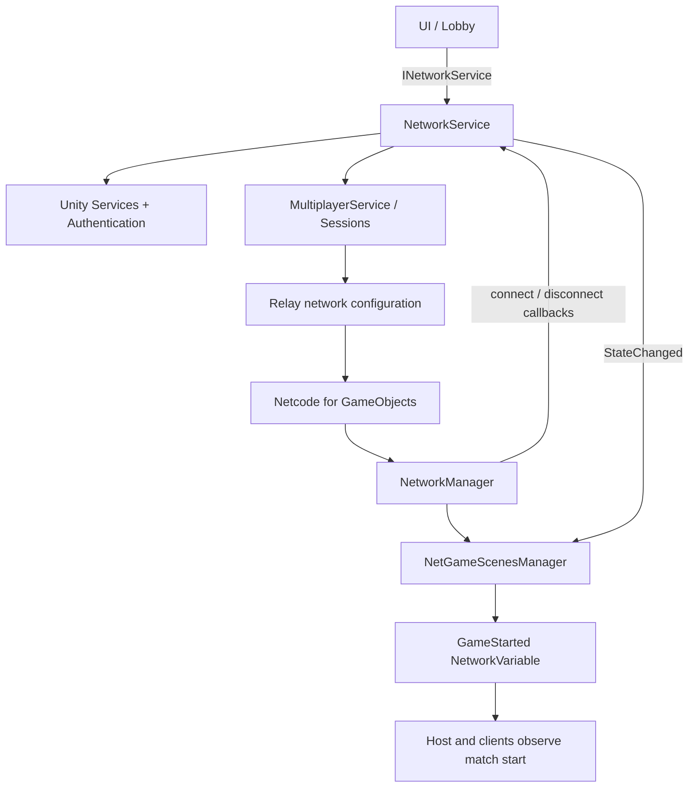

# Сетевая архитектура EnchantedLand

> Документ составлен по исходному коду текущей ветки `main`. Он описывает существующую реализацию и отдельно помечает незавершённые места.

## 1. Технологии и ответственность

Сетевая часть объединяет три уровня:

1. **Unity Gaming Services (UGS)** — инициализация сервисов, анонимная аутентификация, Multiplayer Sessions и свойства сессии.
2. **Relay** — транспортное соединение участников через `WithRelayNetwork()`.
3. **Netcode for GameObjects (NGO)** — сетевые игровые объекты, клиентские подключения и синхронизация `NetworkVariable`.

Основные файлы:

- `Assets/Common/Scripts/Network/INetworkService.cs`
- `Assets/Common/Scripts/Network/NetworkService.cs`
- `Assets/Common/Scripts/Network/NetworkState.cs`
- `Assets/EnchantedLand/NetGame/Scripts/NetGameScenesManager.cs`
- `Assets/EnchantedLand/NetGame/Scripts/NetPlayer.cs`

## 2. Схема взаимодействия



Важно: схема отражает архитектурное назначение компонентов. В проекте нужно отдельно проверить фактическую конфигурацию `NetworkManager`, `UnityTransport`, сетевых prefab и вызовы запуска NGO. Сам факт создания Multiplayer Session ещё не доказывает, что сетевой игровой объект уже появился и готов к синхронизации.

## 3. Контракт INetworkService

Интерфейс предоставляет операции:

| Метод | Назначение | Результат |
|---|---|---|
| `CreateHostAsync(int maxPlayers, string mapId)` | Создать сессию хоста | Код подключения или `null` |
| `JoinAsync(string joinCode)` | Подключиться по коду | `NetworkConnectionResult` |
| `QuickJoinAsync(int maxPlayers, string mapId)` | Найти доступную сессию по карте | `bool` |
| `StartMatchAsync()` | Закрыть сессию для новых участников и сообщить о старте | `bool` |
| `OpenMatchmakingAsync()` | Разрешить новым участникам присоединяться снова | `bool` |
| `DisconnectAsync()` | Покинуть текущую сессию | `UniTask` |

Состояние читается через `State`, а изменения публикуются через `StateChanged`. Реализация `NetworkService` также содержит событие `ConnectedPlayersChanged`, свойства `MatchStarted` и `MaxPlayers`, но эти элементы не объявлены в текущем `INetworkService`. Если потребителям нужен доступ к ним через интерфейс, добавьте их в контракт или используйте отдельный интерфейс.

## 4. Состояния сети

Enum `NetworkState` содержит:

- `Disconnected` — нет активной сессии.
- `Initializing` — инициализация UGS и Authentication.
- `CreatingSession` — создаётся сессия хоста.
- `JoiningSession` — выполняется присоединение или поиск сессии.
- `Connecting` — предусмотренное состояние подключения; в показанном `NetworkService` отдельно не устанавливается.
- `Connected` — операция создания/присоединения к сессии завершилась успешно.
- `Failed` — операция завершилась исключением или некорректным кодом.
- `Started` — хост вызвал старт матча и закрыл сессию для новых участников.

`Connected` означает, что операция UGS Session завершилась, но это не следует без дополнительной проверки трактовать как подтверждение, что все NGO PlayerObjects созданы.

Метод `SetState` не вызывает событие повторно, если состояние не изменилось. При смене состояния он сохраняет значение, пишет лог и синхронно вызывает `StateChanged`.

## 5. Инициализация UGS

`InitializeAsync()` выполняет следующие шаги:

1. Проверяет флаг `_initialized`.
2. Вызывает `UnityServices.InitializeAsync()`.
3. Если пользователь не вошёл в систему, вызывает `AuthenticationService.Instance.SignInAnonymouslyAsync()`.
4. Устанавливает `_initialized = true`.

Это анонимная аутентификация. Для production необходимо продумать связывание анонимной учётной записи с постоянным способом входа, обработку повторной авторизации и ошибки сети. Флаг инициализации не сбрасывается при `DisconnectAsync()`, что позволяет не инициализировать UGS повторно при следующем подключении в рамках жизни приложения.

## 6. Создание сессии хоста

`CreateHostAsync(maxPlayers, mapId)`:

1. Устанавливает `Initializing`.
2. Инициализирует UGS и Authentication.
3. Устанавливает `CreatingSession`.
4. Создаёт `SessionOptions` с `MaxPlayers`.
5. Добавляет публичное свойство `mapId` с индексом `PropertyIndex.String1`.
6. Добавляет Relay-конфигурацию через `WithRelayNetwork()`.
7. Вызывает `MultiplayerService.Instance.CreateSessionAsync(options)`.
8. Сохраняет `ISession`, сбрасывает локальный `_matchStarted`, устанавливает `Connected`, подписывается на callbacks NGO и возвращает `_session.Code`.

При исключении сервис устанавливает `Failed`, пишет ошибку и возвращает `null`.

**Замечание:** публичное свойство `mapId` — строка. В `JoinAsync` код пытается преобразовать значение в `int` для `NetworkConnectionResult.MapId`. Поэтому вызывающий код должен передавать числовую строку, если ожидается успешное заполнение `MapId`; для произвольного строкового ID текущий DTO требует изменения.

## 7. Подключение по коду

`JoinAsync(joinCode)`:

1. Создаёт результат с `Success = false`.
2. Отклоняет пустой код и переводит сервис в `Failed`.
3. Инициализирует UGS.
4. Устанавливает `JoiningSession`.
5. Вызывает `JoinSessionByCodeAsync(joinCode)`.
6. Устанавливает `Connected`, заполняет `Success` и `CountPlayer`.
7. Если свойство `mapId` существует и разбирается как число, заполняет `MapId`.
8. Подписывается на события подключения NGO и возвращает результат.

В текущей реализации `CountPlayer` заполняется значением `_session.MaxPlayers` — это максимальная вместимость, а не текущее количество участников. Если поле должно обозначать фактическое число игроков, его следует переименовать или получать текущий count из NGO.

## 8. Quick Join / Matchmaking

`QuickJoinAsync(maxPlayers, mapId)` использует:

- `Timeout = 10 секунд`;
- `CreateSession = false` — не создавать новую сессию, если подходящая не найдена;
- фильтр `FilterField.StringIndex1 == mapId`;
- `SessionOptions.MaxPlayers = maxPlayers`;
- `WithRelayNetwork()`;
- перегрузку `MatchmakeSessionAsync(quickJoinOptions, sessionOptions)`.

Важное условие: свойство карты при создании сессии индексируется как `PropertyIndex.String1`, а Quick Join фильтрует `FilterField.StringIndex1`. Значения `mapId` и `maxPlayers` у хоста и клиента должны быть совместимы с фактическими параметрами поиска. Если подходящая открытая сессия отсутствует, метод перехватывает исключение, устанавливает `Failed` и возвращает `false`.

## 9. Запуск и повторное открытие матчмейкинга

### StartMatchAsync

Метод проверяет наличие сессии и то, что матч ещё не отмечен запущенным. Затем получает host-представление сессии через `_session.AsHost()`, устанавливает `IsLocked = true`, ставит локальный флаг `_matchStarted = true` и публикует `NetworkState.Started`.

Вызов должен выполняться только на хосте. Сейчас метод объявлен как `async`, но не содержит `await`; это не мешает синхронным действиям, но предупреждение компилятора можно убрать, изменив сигнатуру или действительно добавив асинхронную операцию, если это нужно API.

### OpenMatchmakingAsync

Метод снимает `IsLocked` через `_session.AsHost()` и сбрасывает `_matchStarted`. Он не вызывает `SetState(Connected)` и не публикует отдельное событие об открытии матчмейкинга. Поэтому слушатели `StateChanged` не узнают о повторном открытии по этому событию.

### Важное различие

`ISession.IsLocked` управляет возможностью новых участников присоединяться к сессии. Это не то же самое, что остановка игрового процесса, завершение матча или запрет RPC/изменения состояния игры. Эти правила нужно отдельно реализовать в игровом слое и проверять на сервере.

## 10. События подключённых клиентов

`NetworkService` подписывается на:

- `NetworkManager.Singleton.OnClientConnectedCallback`;
- `NetworkManager.Singleton.OnClientDisconnectCallback`.

Оба callback читают `NetworkManager.Singleton.ConnectedClients.Count`, пишут лог и вызывают `ConnectedPlayersChanged(count)`.

Подписка происходит после успешного создания/присоединения/Quick Join. Отписка выполняется в `DisconnectAsync()`. Если повторная операция подключения вызвана до очистки предыдущих подписок, есть риск накопления подписок. Надёжнее сделать подписку идемпотентной: сначала отписывать те же обработчики, затем подписывать; также централизованно очищать их при завершении сессии.

В текущем коде обработчики проверяют наличие `NetworkManager.Singleton`, но не проверяют его перед чтением `ConnectedClients` внутри callback. В обычном случае callback вызывается от самого менеджера, однако при смене/уничтожении NetworkManager следует аккуратно контролировать жизненный цикл.

## 11. Сетевой старт матча: NetGameScenesManager

Компонент наследуется от `NetworkBehaviour` и имеет:

```csharp
public NetworkVariable<bool> GameStarted =
    new NetworkVariable<bool>(
        false,
        NetworkVariableReadPermission.Everyone,
        NetworkVariableWritePermission.Server);
```

Это серверно-авторитетный флаг: клиенты могут читать значение, но изменять его может сервер.

При `OnNetworkSpawn()` менеджер подписывается на `GameStarted.OnValueChanged`, сразу обрабатывает текущее значение (на случай, если оно уже `true`) и подписывается на `NetworkService.StateChanged`.

Когда локальный сервис сообщает `NetworkState.Started`, менеджер выставляет `GameStarted.Value = true`. Это допустимо только если данный экземпляр действительно работает на сервере/хосте. Клиентская запись вызовет нарушение правил NetworkVariable; рекомендуется явно защитить ветку проверкой `IsServer`.

При значении `true` метод `OnGameStartedChanged` вызывает `PlaceAllPlayers()` и закрывает окна UI. Но в текущей версии `PlaceAllPlayers()` полностью закомментирован: расстановка игроков фактически не выполняется. `_spawnPoints` также нигде не заполняется в активном коде. Перед использованием нужно реализовать назначение spawn points, серверную расстановку объектов и проверку наличия PlayerObject.

### Потенциальная ошибка порядка инициализации

`OnNetworkSpawn()` обращается к `_networkService.StateChanged`. Зависимости задаются методом `[Inject] Construct(...)`. Убедитесь, что Zenject-инъекция выполнена до сетевого spawn объекта. Если prefab создаётся напрямую через NGO, инъекция Zenject не гарантируется автоматически.

Кроме того, `OnNetworkDespawn()` снимает подписку с `_networkService`; при отсутствии инъекции это может вызвать `NullReferenceException`. Можно защититься проверкой на null, но правильнее гарантировать инъекцию до spawn.

## 12. NetPlayer и инъекция

`NetPlayer` наследуется от `NetworkBehaviour` и имеет поле:

```csharp
[Inject] public PlayerManager _playerManager;
```

Метод `PrepareForGame()` пока пустой. Если prefab создаётся через стандартный NGO spawn, Zenject автоматически не выполняет `[Inject]` на компонентах. В коде `NetGameScenesManager` есть закомментированный пример `_container.InjectGameObject(playerObject.gameObject)`, но он не исполняется.

Рекомендуемый порядок:
1. На стороне сервера создать/подготовить объект.
2. Выполнить Zenject-инъекцию до того, как компонент начнёт использовать зависимости, либо отказаться от прямой DI в сетевом prefab и передавать ему явные данные/ссылки через фабрику.
3. Выполнить NGO spawn после необходимой подготовки, если это совместимо с выбранной архитектурой.
4. Не инжектировать один и тот же объект повторно без необходимости.
5. Не пытаться вызывать локальный `PlayerManager` одного клиента как источник истины для всех клиентов: локальные сохранения не являются общей сетевой базой данных.

Точный механизм зависит от того, где именно создаётся PlayerObject — через `NetworkManager` prefab flow, кастомный серверный spawn или отдельную фабрику. Текущие активные файлы не показывают завершённый flow создания игрока.

## 13. Что проверить в Unity Inspector

- В сцене сетевой игры есть ровно один активный `NetworkManager`.
- На том же объекте настроен `UnityTransport), если он используется выбранной схемой NGO.
- Назначен Player Prefab с `NetworkObject`.
- Player Prefab добавлен в список Network Prefabs.
- `NetGameScenesManager` расположен на сетевом объекте с `NetworkObject`, если его `NetworkVariable` должна реплицироваться.
- Все необходимые зависимости зарегистрированы в ProjectContext/SceneContext и инъекция происходит до `OnNetworkSpawn`.
- Хост и клиенты используют согласованные значения `maxPlayers` и `mapId`.
- Старт матча и закрытие сессии разрешены только хосту.

## 14. Рекомендуемый план доработки

1. Явно разделить состояние UGS-сессии и состояние NGO-транспорта/матча, если они используются как разные этапы.
2. Сделать `SubscribeNetworkEvents()` идемпотентным.
3. Добавить серверную проверку в `NetGameScenesManager` перед записью `GameStarted`.
4. Реализовать spawn points и серверную расстановку PlayerObjects.
5. Определить надёжную стратегию DI для сетевого prefab.
6. Разделить `MaxPlayers` и `ConnectedPlayersCount`.
7. Определить поведение при выходе хоста, отключении клиента, повторном подключении и закрытии сессии.
8. Добавить тесты: создание сессии, вход по коду, Quick Join, полный матч, late join после lock, повторное открытие matchmaking и Disconnect.
